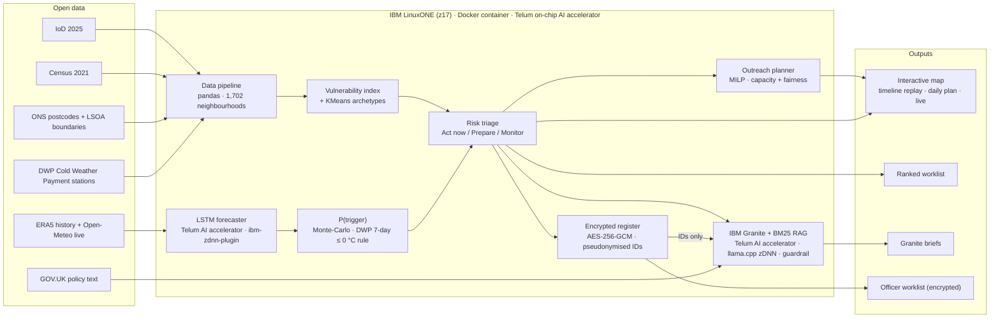
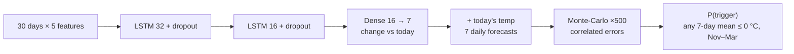

# ColdWatch: real-time cold-weather triage on IBM LinuxONE

**Team AUniqueName · IBM Z Datathon 2026 · Event code SSF2026**

> Which neighbourhoods need help *before* the freeze, what should outreach teams do there, and who should they visit tomorrow morning?

ColdWatch combines a **vulnerability index** for every neighbourhood in Greater Manchester with an **LSTM freeze forecast running on the IBM Telum on-chip AI accelerator**. It ranks where to act first, and an **integer-programming planner** turns the risk forecast into a **daily outreach plan** within real staffing limits. **IBM Granite** writes a grounded, guardrailed action brief for each priority area. Personal data stays encrypted on the mainframe; the AI only ever sees pseudonymised aggregates.

**Theme:** Real-time AI for Critical Decisions (*Detect · Decide · Respond*), with an *AI Secured* privacy layer.

---

## The problem
Cold homes are a serious health risk for older, isolated and disabled people. Help exists (Cold Weather Payments, the Warm Home Discount, council welfare calls), but it is **reactive**:
- A Cold Weather Payment only triggers once an area's average temperature has been at or below 0 °C for 7 consecutive days.
- Outreach teams have no ranked view of *which streets to prioritise*, *what kind of help* each needs, or *how to spend limited visits* before the cold arrives.

## What ColdWatch does
| Question | Model | Runs on |
|---|---|---|
| **Who** is vulnerable? | Transparent weighted index (6 Census / IoD inputs, percentile-ranked) | LinuxONE CPU |
| **What kind** of need? | KMeans archetypes (3 need types) | LinuxONE CPU |
| **When** will it freeze? | LSTM forecasting each of the next 7 days' mean temperature | **Telum AI accelerator** (`ibm-zdnn-plugin`) |
| **How likely** a payment trigger? | Monte-Carlo over the LSTM's correlated errors, using DWP's 7-day ≤ 0 °C rule | LinuxONE CPU |
| **Where** first? | Risk = vulnerability × P(trigger) → Act now / Prepare / Monitor | LinuxONE CPU |
| **Who** do we visit tomorrow? | Daily mixed-integer programme (SciPy `milp` / HiGHS): which areas to visit under capacity, borough-team and need-type fairness constraints | LinuxONE CPU |
| **What** should we do? | IBM Granite + BM25 retrieval over GOV.UK policy, with a numeric guardrail | **Telum AI accelerator** (llama.cpp zDNN build) |
| **Who may see what?** | AES-256-GCM encrypted register; pseudonymised IDs passed to AI | LinuxONE (CPACF crypto) |

## Architecture



### Hazard model



### Outreach planner (solved every morning, using only that day's forecast)

```
maximise    Σ x_i · n_i · v_i · P_i             expected vulnerable older people protected
subject to  Σ x_i ≤ K                           daily visit capacity across Greater Manchester
            Σ_{i ∈ borough b} x_i ≤ cap_b       each borough's team share (by older-alone population)
            Σ_{i ∈ need g} x_i ≥ 15% of visits  fairness floor for every need type
            x_i = 0 if visited in the last 7 days or P_i < 0.2
            x_i ∈ {0, 1}
n_i = older people living alone · v_i = vulnerability index · P_i = P(payment trigger in 7 days)
```

Rendered diagrams: [`images/architecture.png`](images/architecture.png) · [`images/decision_flow.png`](images/decision_flow.png) · [`images/lstm_model.png`](images/lstm_model.png) · [`images/planner_reach.png`](images/planner_reach.png)

---

## How IBM Z / LinuxONE is used
| Capability | Where | Evidence |
|---|---|---|
| **Telum on-chip AI accelerator (NNPA)** via `ibm-zdnn-plugin` | LSTM inference (TensorFlow 2.18) | `nnpa` CPU facility; `_z_ops.so` and `libzdnn.so` loaded in the inference process; batch-throughput benchmark |
| **Telum AI accelerator** via llama.cpp built with `-DGGML_ZDNN=ON` | IBM Granite 4.0 briefs (big-endian GGUF for s390x) | `libggml-zdnn` backend library |
| **CPACF on-chip crypto** | Platform AES for encryption at rest | `msa` CPU facility flags |
| **Containerised workload** | Entire pipeline runs in the LinuxONE `notebook` container on a persistent volume | `docker ps` / `docker inspect` |
| **Scale** | Every English neighbourhood scored in one pass | `zcold/scale.py` timing |

Screenshots and an index of what each proves: [`evidence/`](evidence/)

## Results (unseen test winters 2022–23 → 2025–26)
*Values from the executed notebook [`ColdWatch_Story.ipynb`](ColdWatch_Story.ipynb) (seed 42).*

### Forecast and trigger probability
| Metric | LSTM | Persistence baseline |
|---|---|---|
| Brier score (lower = better) | **0.018** | 0.039 |
| AUC | **0.973** | — |
| Precision / recall at P ≥ 0.5 | **57% / 52%** | 38% / 70% |
| False alarms at P ≥ 0.5 | **13** | 37 |
| Forecast error, day 1 | **1.65 °C** | 1.74 °C |
| Forecast error, day 7 | **2.57 °C** | 3.29 °C |

### December 2022 cold spell (replay; the model never saw this winter)
| Station area | Freezing week completed | *Prepare* from | *Act now* from |
|---|---|---|---|
| Rochdale | 12 Dec | 7 Dec (**5 days early**) | 9 Dec (**3 days early**) |
| Rostherne | 13 Dec | 9 Dec (**4 days early**) | 12 Dec (**1 day early**) |

On 9 Dec 2022: **268 neighbourhoods on Act now, home to 29,407 older people living alone**. By 14 Dec: 679 neighbourhoods and 76,147 people.

### Decision support: the ColdWatch Planner
Back-tested on every test winter, which contained 3 freezing weeks (Rochdale Dec 2022 and Jan 2025, Rostherne Dec 2022). An area counts as *reached in time* if it was visited in the 7 days before its station's freezing week completed. The table shows the % of older people living alone in the 679 priority neighbourhoods (76,147 people) reached in time.

| Visits per day | ColdWatch planner | Same optimiser, naive forecast | Forecast-free rota, same visits | Today (reactive) |
|---|---|---|---|---|
| 10 | **12.3%** | 11.4% | 0.8% | 0% |
| 20 | **20.3%** | 18.8% | 1.3% | 0% |
| 40 | **34.0%** | 31.9% | 3.4% | 0% |
| 80 | **57.4%** | 55.5% | 4.2% | 0% |

- **With the same number of visits, ColdWatch reaches 10–15× more people before the trigger** than a fixed rota.
- It needs **~11% fewer visits** than the naive-forecast planner and spends fewer of them on false alarms (58% vs 64%; the rota spends 97%).
- False alarms are deliberately precautionary: planning starts at P(trigger) ≥ 0.2.
- *Caveat:* only 3 freezing weeks occurred in the test winters, so treat these results as indicative, not definitive.

### Platform and validation
- **Throughput:** up to **33,363 LSTM forecasts per second** on IBM Z (batch 10,000).
- **Scalability:** the full model pipeline scores all **33,755 English neighbourhoods in ~1.5 s** (~22,600 per second). The highest-vulnerability local authorities are coastal: Blackpool, North Norfolk, Isles of Scilly, East Lindsey, Torbay.
- **Index validation:** Spearman ρ = 0.32 against official fuel poverty, 0.33 against IMD and health deprivation (p < 0.001).

---

## Repository structure
```
zcold/                    # Python package (all models + pipeline)
  structural.py           # [1] vulnerability index + KMeans archetypes
  hazard.py               # [2] LSTM on IBM Z, Monte-Carlo P(trigger), benchmark, live forecast
  scoring.py              # [3] risk triage (replay or live)
  planner.py              # [4] daily outreach plan (MILP) + back-test against baselines
  privacy.py              # encrypted synthetic register + pseudonymised AI view
  briefs.py               # [5] IBM Granite + BM25 briefs with guardrail
  mapviz.py               # interactive map (timeline replay, daily plan, live mode)
  scale.py                # national scalability run (33,755 neighbourhoods)
  diagrams.py             # architecture / flow diagrams
src/                      # data extraction scripts (IoD, Census, ONSPD, boundaries, stations, ERA5, labels)
ColdWatch_Story.ipynb     # end-to-end run-through on LinuxONE (executed, with outputs)
images/                   # rendered diagrams and charts
models/                   # trained LSTM + metrics
outputs/                  # interactive map HTML (prototype)
evidence/                 # platform evidence screenshots + index (evidence/README.md)
```

## How to run (LinuxONE Community Cloud)
Everything runs inside the provided `notebook` container (Python `/opt/venv`, TensorFlow + `ibm-zdnn-plugin`, llama.cpp zDNN build). The project lives in the shared volume: host `~/shared/zcold` = container `/home/ibm-user/shared/zcold`.

```bash
# extra packages (pure Python / C, no TensorFlow or NumPy changes)
docker exec notebook /opt/venv/bin/pip install -r /home/ibm-user/shared/zcold/requirements.txt

# 1. data: download the sources listed below into data/raw/, then run the extract scripts in src/
# 2. pipeline
cd ~/shared/zcold
docker exec -w /home/ibm-user/shared/zcold notebook python -m zcold.structural
docker exec -w /home/ibm-user/shared/zcold notebook python -m zcold.hazard
docker exec -w /home/ibm-user/shared/zcold notebook python -m zcold.scoring 2022-12-09
docker exec -w /home/ibm-user/shared/zcold notebook python -m zcold.privacy 2022-12-09
docker exec -w /home/ibm-user/shared/zcold notebook python -m zcold.briefs 2022-12-09
docker exec -w /home/ibm-user/shared/zcold notebook python -m zcold.planner
docker exec -w /home/ibm-user/shared/zcold notebook python -m zcold.mapviz 2022-12-09
docker exec -w /home/ibm-user/shared/zcold notebook python -m zcold.mapviz live
docker exec -w /home/ibm-user/shared/zcold notebook python -m zcold.scale        # optional: all of England
```
Or open `ColdWatch_Story.ipynb` in Jupyter and **Run All**.

**Using the map** (`outputs/coldwatch_map_2022-12-09.html`):
- Press **▶** to replay 1–14 Dec 2022.
- Hover an area for its risk; click a numbered pin for its Granite brief.
- Switch the **Outreach plan** capacity (Off / 10 / 20 / 40 / 80 visits per day) to see the optimised daily visits, outlined in cyan.

Data files are not committed (size and licence terms); all sources are open and listed below.

## Data sources
| Dataset | Publisher | Licence |
|---|---|---|
| [English Indices of Deprivation 2025](https://www.gov.uk/government/statistics/english-indices-of-deprivation-2025) | MHCLG | OGL v3.0 |
| [Census 2021 bulk tables](https://www.nomisweb.co.uk/sources/census_2021_bulk) (TS007A, TS003, TS038, TS045) | ONS / Nomis | OGL v3.0 |
| [ONS Postcode Directory, May 2026](https://open-geography-portalx-ons.hub.arcgis.com/datasets/ons::ons-postcode-directory-may-2026) | ONS | OGL v3.0 (contains Royal Mail, OS and ONS data) |
| [LSOA December 2021 boundaries (BGC)](https://open-geography-portalx-ons.hub.arcgis.com/datasets/ons::lower-layer-super-output-areas-december-2021-boundaries-ew-bgc-v5-2) | ONS | OGL v3.0 (contains OS data) |
| [Sub-regional fuel poverty, 2024 data](https://www.gov.uk/government/statistics/sub-regional-fuel-poverty-data-2026-2024-data) (validation only) | DESNZ | OGL v3.0 |
| [Cold Weather Payment estimates + station/postcode file](https://www.gov.uk/government/statistics/cold-weather-payment-estimates-2025-to-2026) | DWP | OGL v3.0 |
| [UK synoptic and climate stations](https://www.metoffice.gov.uk/research/climate/maps-and-data/uk-synoptic-and-climate-stations) (coordinates) | Met Office | Met Office terms |
| [Historical Weather API (ERA5)](https://open-meteo.com/en/docs/historical-weather-api) and Forecast API | Open-Meteo / Copernicus | CC BY 4.0 |
| [Cold Weather Payment](https://www.gov.uk/cold-weather-payment), [Warm Home Discount](https://www.gov.uk/the-warm-home-discount-scheme) policy text | GOV.UK | OGL v3.0 |
| Basemap tiles | Esri (World Dark/Light Gray Canvas) | Esri terms |

## Privacy and responsible AI
- **Privacy by design:** the resident register is **synthetic** (fake names, Ofcom fiction-range phone numbers). It is encrypted with **AES-256-GCM** at rest and decrypted only in memory. Granite receives **pseudonymised, aggregated** inputs only; names never reach the AI.
- **Grounded generation:** code writes every number in a brief. Granite writes one action line from retrieved policy text, and a **guardrail rejects any number not present in the source facts** and substitutes an approved action.
- **Fair allocation:** the planner reserves at least 15% of each day's visits for every need type and splits capacity across boroughs by population, so one group cannot crowd out the others.
- **Human in the loop:** ColdWatch prioritises and plans outreach; it does not decide entitlement. Decisions stay with council officers.

## Limitations
- Area-level (LSOA) data identifies *where* to look, not which individual is at risk.
- ERA5 reanalysis approximates, but is not identical to, the Met Office station readings DWP uses.
- Vulnerability weights are expert judgement (there is no LSOA-level outcome data to learn them from). They are transparent and validated against official measures.
- The LSTM learns from past temperatures, so it cannot foresee the *onset* of a cold snap; production use would add weather-forecast inputs.
- Two DWP stations cover Greater Manchester, so within a station area, ranking is driven by vulnerability.
- The planner treats a "visit" as one outreach push per neighbourhood and uses simplified team capacities. Its back-test covers only 3 freezing weeks.
- Two LSOAs (central Manchester, districts M60/M61) are mapped by inference; see `src/station_mapping.py`.

## Open-source software
[TensorFlow](https://github.com/tensorflow/tensorflow) ·
[ibm-zdnn-plugin](https://pypi.org/project/ibm-zdnn-plugin/) ·
[IBM zDNN](https://github.com/IBM/zDNN) ·
[llama.cpp](https://github.com/ggml-org/llama.cpp) ·
[llama-cpp-python](https://github.com/abetlen/llama-cpp-python) ·
[IBM Granite](https://huggingface.co/ibm-granite) ·
[rank_bm25](https://github.com/dorianbrown/rank_bm25) ·
[scikit-learn](https://github.com/scikit-learn/scikit-learn) ·
[SciPy](https://github.com/scipy/scipy) (`milp`) ·
[HiGHS](https://github.com/ERGO-Code/HiGHS) ·
[pandas](https://github.com/pandas-dev/pandas) ·
[NumPy](https://github.com/numpy/numpy) ·
[Matplotlib](https://github.com/matplotlib/matplotlib) ·
[folium](https://github.com/python-visualization/folium) ·
[Leaflet](https://github.com/Leaflet/Leaflet) ·
[PyCryptodome](https://github.com/Legrandin/pycryptodome) ·
[openpyxl](https://foss.heptapod.net/openpyxl/openpyxl) ·
[odfpy](https://github.com/eea/odfpy)

## Acknowledgements
- IBM LinuxONE Community Cloud and the IBM Z Datathon AI labs. Patterns are adapted from the IBM reference notebooks (*Loan Approval: Predictive + Generative AI* and *Fraud detection LSTM*), credited here. All ColdWatch code was written during the datathon (17–18 October 2026).
- Shooting Stars Foundation and the IBM Z mentors.

## Team
- Hector Pearson: models, pipeline, planner, map, notebook
- Daniel Mao: data engineering, weather stations, labels, policy integration
